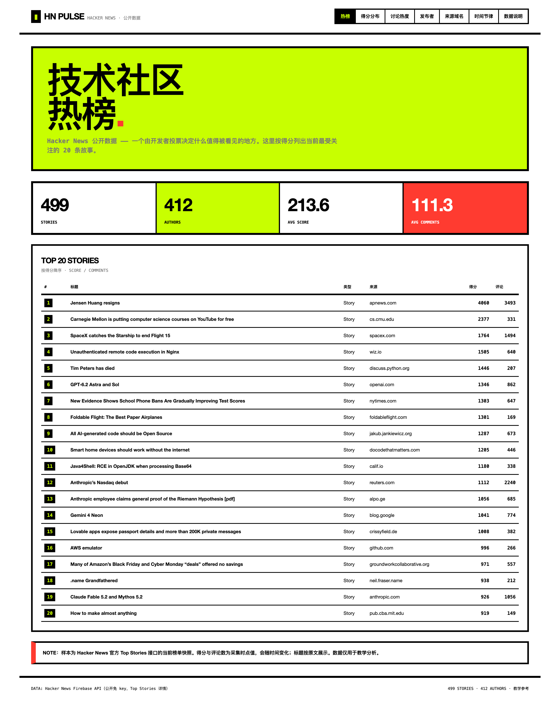
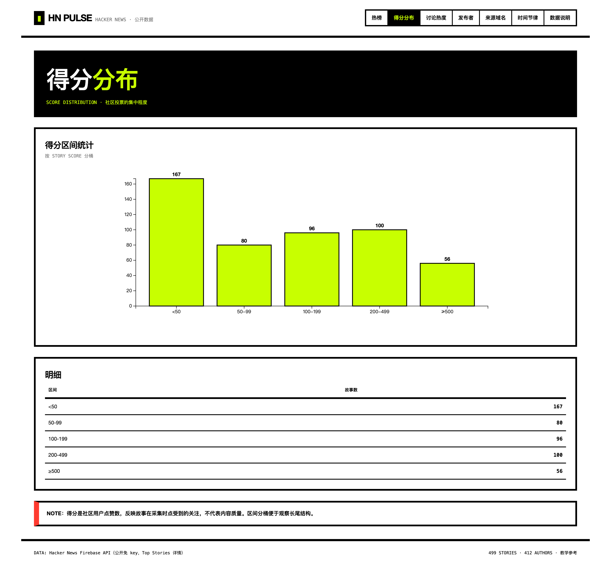
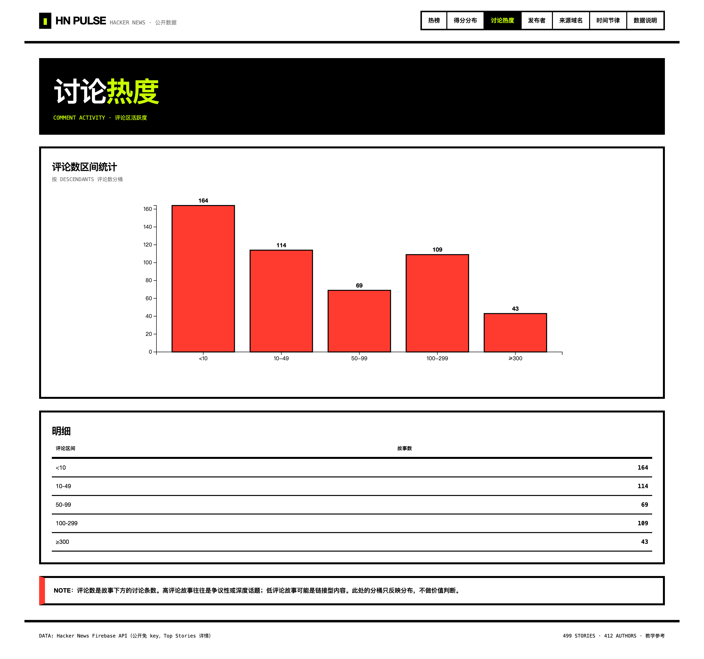
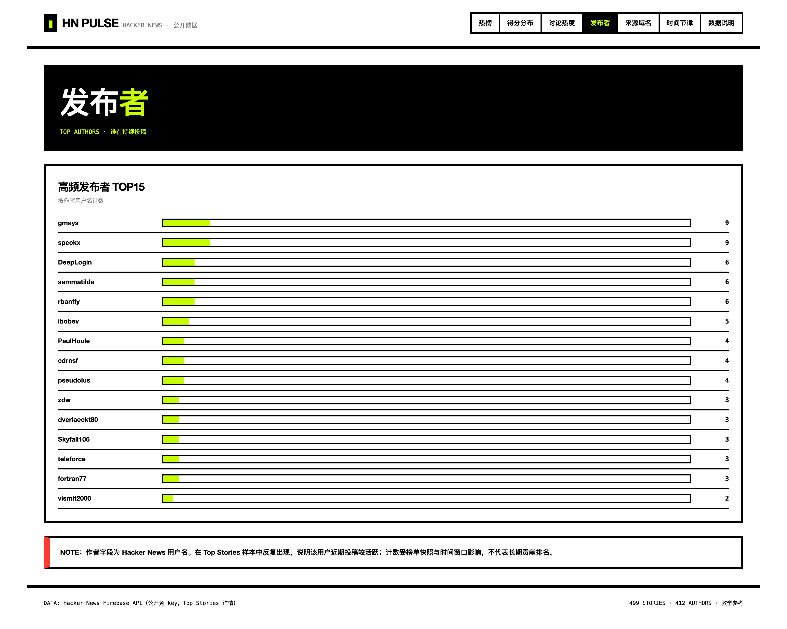
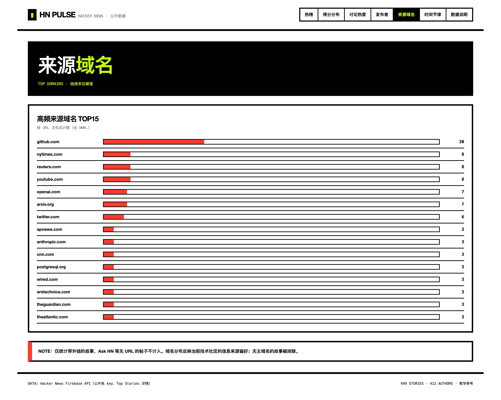
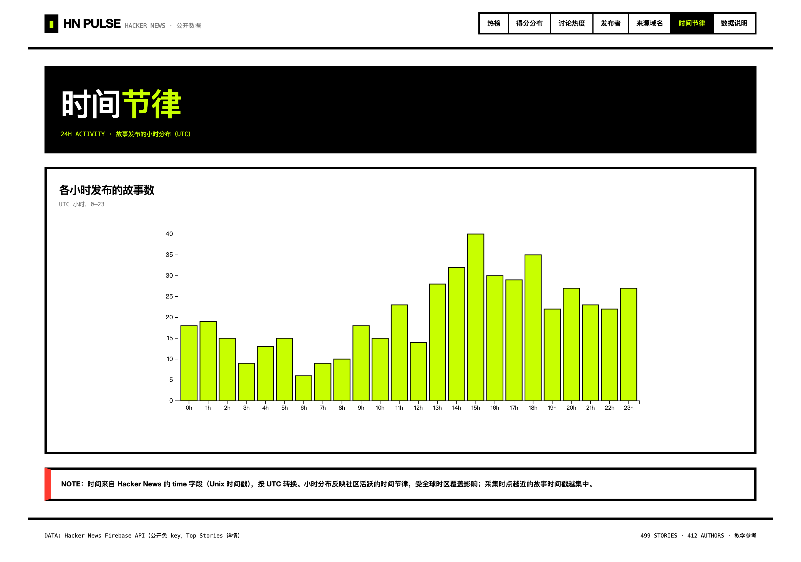
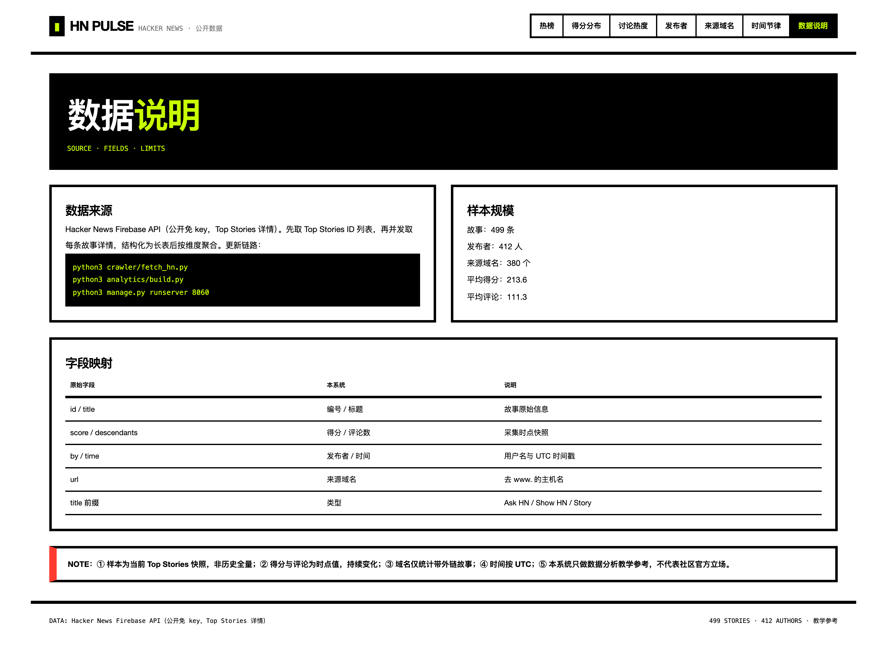

# 060 基于Hacker News公开数据的技术社区热点分析系统-设计展示

> **代码有偿获取 可接受定制 微信联系方式: csbysj2020 或 ACE2487，备注(BS)**

> **完整源码与全套文档 · 在线自助获取 >>> [https://mbd.pub/o/bread/YZaWmJpqaQ==](https://mbd.pub/o/bread/YZaWmJpqaQ==)**

> **成品页（功能介绍 / 更多选题）>>> [https://bishe.suilang.net/products/hn-pulse](https://bishe.suilang.net/products/hn-pulse)**

> 

> 

## 视频

> **点击查看 >>> [https://www.bilibili.com/video/BV12JyszrE6A/](https://www.bilibili.com/video/BV12JyszrE6A/)**

## 项目简介

粗野/瑞士海报风格（纯白底、粗黑框、荧光绿与红、超粗无衬线），区别于所有既往视觉。采集 Hacker News Firebase API 公开数据 499 条故事，从热榜、得分、讨论、发布者、域名与小时节律六维分析。Django + D3.js（本地化离线可用），7 个页面。榜单快照与时点值口径如实标注，仅作教学参考，不代表社区官方立场。

技术社区的热点结构反映开发者群体的关注方向。

本项目设计并实现了一套基于 Hacker News 公开数据的技术社区热点分析系统：通过 Firebase API 获取 Top Stories 列表并并发抓取详情，入库 499 条故事，从热榜、得分区间、讨论热度、发布者、来源域名与小时节律六个维度聚合分析。

系统采用 Django + D3.js 与粗野/瑞士海报式界面（纯白底、粗黑框、荧光绿与红、超粗无衬线），实现热榜、得分分布、讨论热度、发布者、来源域名、时间节律、数据说明 7 个页面。

本仓库为**设计展示**：包含项目说明、技术架构、实验结果与运行截图；完整源码、任务书、开题报告、毕业论文与使用说明可通过上方链接自助获取，成品页可查看更多选题，也可联系微信咨询定制。

## 功能特性

1. 差异化视觉：粗野/瑞士海报（纯白/粗黑框/荧光绿+红），非看板/画廊/报纸/星空/控制台/田野指南

2. 真实采集：Hacker News Firebase API 公开免 key，499 条故事

3. 六维分析：热榜/得分区间/讨论热度/发布者/来源域名/小时节律

4. 发布者：412 位用户名，TOP15 排行

5. 来源域名：380 个域名，GitHub 居首

6. 技术栈差异化：Django + D3.js（本地化），首次使用 D3 数据驱动图表

7. 合规边界：榜单快照与得分时点值如实标注，不代表社区官方立场

## 技术架构

| 项目 | 说明 |
| --- | --- |
| 编程语言 | Python 3.8+ |
| Web 框架 | Django 4.2 |
| 图表 | D3.js（本地化离线可用） |
| 数据源 | Hacker News Firebase API（公开免 key） |
| 样本规模 | 499 故事 / 412 作者 / 380 域名 |
| 运行端口 | http://127.0.0.1:8060 |
| 说明 | 数据直读 analysis JSON，无需数据库 |

## 目录结构

以下为完整交付版的结构（本仓库仅作设计展示）：

```
hn-pulse/
├── analytics/
│   └── build.py
├── crawler/
│   └── fetch_hn.py
├── data/
│   ├── analysis/
│   │   ├── authors.json
│   │   ├── comment_bins.json
│   │   ├── domains.json
│   │   ├── hot.json
│   │   ├── hours.json
│   │   ├── kinds.json
│   │   └── score_bins.json
│   ├── processed/
│   │   └── stories.csv
│   └── stats.json
├── hnapp/
├── hnsite/
│   ├── __init__.py
│   ├── settings.py
│   ├── urls.py
│   ├── views.py
│   └── wsgi.py
├── static/
│   ├── css/
│   │   └── style.css
│   └── vendor/
│       └── d3.min.js
├── templates/
│   ├── about.html
│   ├── authors.html
│   ├── base.html
│   ├── comments.html
│   ├── domains.html
│   ├── hot.html
│   ├── scores.html
│   └── time.html
├── 任务书/
│   └── 毕业设计任务书.docx
├── 开题报告/
│   └── 毕业设计开题报告.docx
├── 最终论文/
└── …
```

## 数据与实验结论

- 实验显示样本覆盖 412 位发布者、380 个来源域名，平均得分 213.6、平均评论 111.3。
- 真实采集：Hacker News Firebase API 公开免 key，499 条故事
- 发布者：412 位用户名，TOP15 排行
- 来源域名：380 个域名，GitHub 居首

## 交付内容

1. 完整源码（Django 应用 + 采集器 + 分析引擎 + 7 页面）
2. 真实数据（stories.csv + analysis JSON）
3. 任务书与开题报告（Word）
4. 毕业论文（Word 七章制）
5. 二次开发说明（Word+md）
6. 7 张截图 + 封面 + 演示视频

## 常见问题

**为什么视觉风格和其他成品差这么多？**

刻意设计：粗野/瑞士海报风格替代看板/画廊/报纸，是差异化探索。

**是历史全量吗？**

不是，是当前 Top Stories 快照，得分与评论为时点值，会持续变化。

**为什么采集慢？**

HN 详情接口单请求约 15 秒，系统用 16 线程并发缩短总时长。

**域名为什么漏掉一些故事？**

Ask HN 等无外链帖子没有域名，未计入来源统计。

**图表能离线用吗？**

能，d3.min.js 已本地化到 static/vendor/。

## 截图








